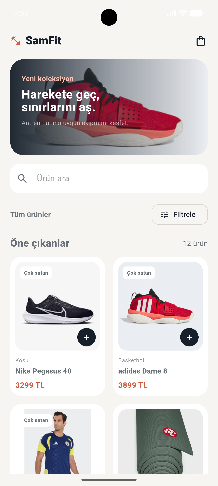
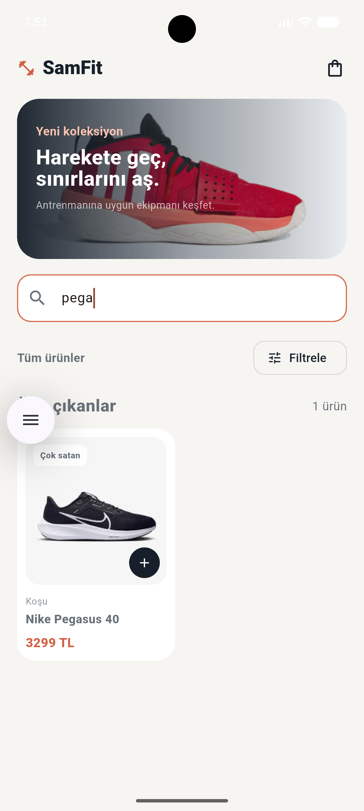
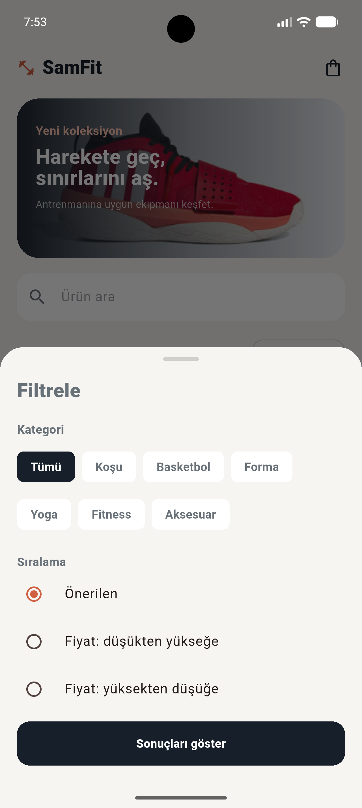
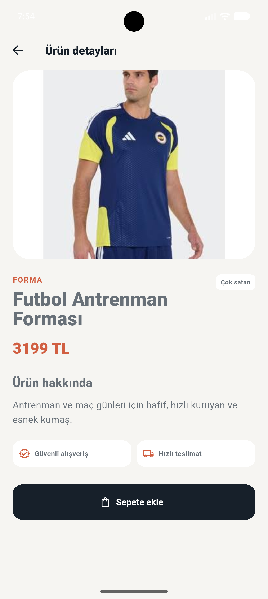
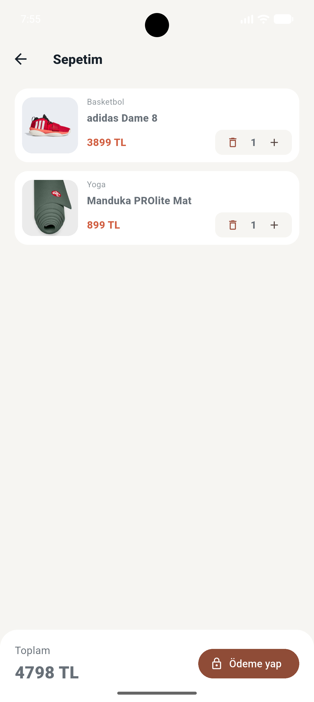
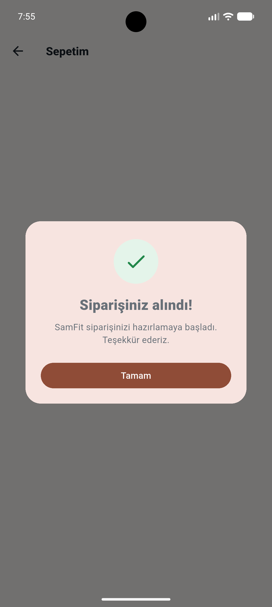

# SamFit

SamFit, spor ürünlerini keşfetmeyi ve sepete eklemeyi kolaylaştıran, Flutter ile geliştirilmiş mobil katalog uygulamasıdır. Uygulamada ürün arama, kategori ve fiyat filtreleme, ürün detaylarını inceleme ve basit sipariş akışı bulunur.

## Ekran görüntüleri

### Ana sayfa ve ürün arama

| Ana sayfa | Ürün arama |
| --- | --- |
|  |  |

### Filtreleme ve ürün detayları

| Filtreleme | Ürün detay |
| --- | --- |
|  |  |

### Sepet ve sipariş

| Sepet | Sipariş tamamlandı |
| --- | --- |
|  |  |

## Öne çıkan özellikler

- Ürünleri iki sütunlu `GridView` düzeninde listeleme
- Ürün adına göre hızlı arama
- Kategori filtreleme
- Önerilen, düşük fiyat ve yüksek fiyat sıralaması
- Ürün detay ekranı
- `Navigator` ile sayfa geçişleri
- `RouteSettings` ile ürün bilgisinin detay ekranına aktarılması
- Ürünleri sepete ekleme, çıkarma ve adet güncelleme
- Sepet toplamını anlık hesaplama
- Sipariş tamamlandığında kullanıcıya bilgilendirme ekranı gösterme
- Yerel ürün görselleri ve uzak görsel yedeği
- Material 3 tabanlı arayüz

## Kullanılan teknolojiler

- Flutter 3.47.9 stable
- Dart 3.13.7
- Material 3
- JSON tabanlı ürün verisi
- Android SDK 37

## Veri ve görsel yönetimi

Ürün verileri `assets/data/products.json` dosyasından okunur. Fiyatların güncel kaynağı `lib/data/product_data.dart` içindeki ürün listesidir. Bu sayede fiyat değişiklikleri tek bir yerden yönetilir.

Ürün görselleri `assets/images/` klasöründe `product_01.jpg` ile `product_12.jpg` arasında tutulur. Yerel görsel bulunamazsa ürünün JSON dosyasındaki uzak görsel adresi yedek olarak kullanılır.

## Proje yapısı

```text
lib/
├─ main.dart
├─ models/
│  └─ product.dart               # Ürün modeli, fromJson ve toJson
├─ data/
│  ├─ product_data.dart          # Ürün listesi ve fiyatlar
│  └─ product_repository.dart    # JSON verisini okuma
├─ screens/
│  ├─ catalog_page.dart          # Ana katalog, arama ve filtreler
│  ├─ product_detail_page.dart   # Ürün detay ekranı
│  └─ cart_page.dart             # Sepet ve sipariş işlemleri
└─ widgets/
   ├─ product_image.dart         # Yerel görsel ve uzak URL yedeği
   └─ product_widgets.dart      # Ürün kartı ve ortak widget'lar
```

## Kurulum

Geliştirme ortamında Flutter SDK, Android Studio ve bir Android emülatörünün kurulu olması gerekir.

Projeyi indirdikten sonra proje klasöründe şu komutları çalıştırın:

```bash
flutter pub get
flutter devices
flutter run
```

## Test ve kalite kontrolü

Kod biçimlendirme, statik analiz ve widget testlerini çalıştırmak için:

```bash
dart format lib test
flutter analyze
flutter test
```

## Not

Bu proje eğitim ve portföy çalışması amacıyla hazırlanmıştır. Ürün, sepet ve sipariş işlemleri gerçek bir ödeme altyapısına bağlı değildir; uygulama içi akışı göstermek üzere simüle edilir.
